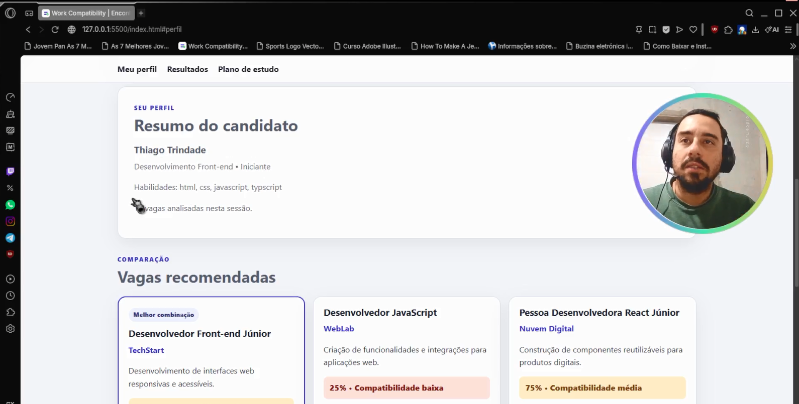
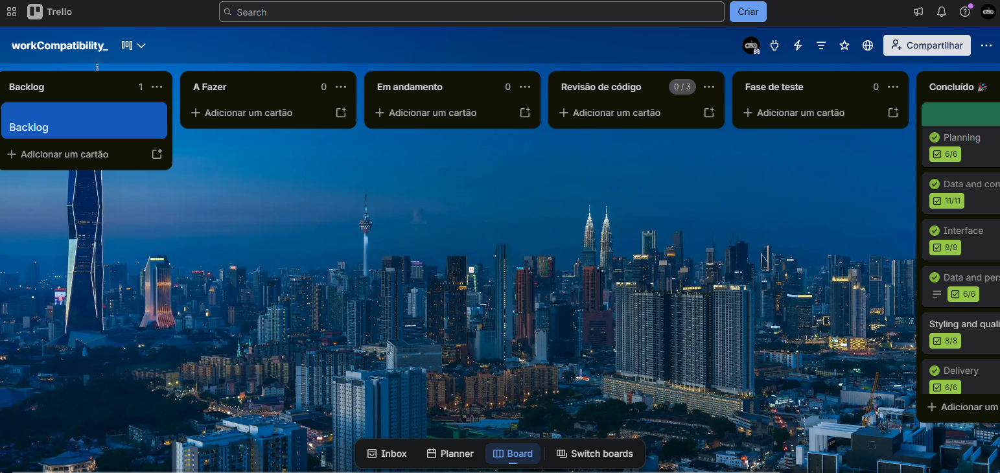

# workCompatibility

Aplicação web educacional que compara as habilidades de uma pessoa com um catálogo de vagas, mostra a porcentagem de compatibilidade e sugere o próximo assunto a estudar.

## 1. Estrutura do projeto

```text
skillmatch-web/
├── index.html                       # Estrutura semântica da página
├── package.json                     # Comandos de execução e teste
├── README.md                        # Este guia
├── tests/
│   └── motor.test.js                # Testes automatizados das regras
└── assets/
    ├── data/
    │   └── vagas.json               # Catálogo de vagas
    ├── img/
    │   └── logo.svg                 # Identidade visual
    ├── scripts/
    │   ├── dados.js                 # Fetch e localStorage
    │   ├── main.js                  # Coordenação da aplicação
    │   ├── motor.js                 # Regras de compatibilidade
    │   └── ui.js                    # Criação e atualização do HTML
    └── styles/
        └── index.style.css          # Estilos mobile-first
```

## 2. Como executar

É necessário ter o [Node.js](https://nodejs.org/) instalado. No terminal aberto na raiz do projeto, execute:

```powershell
npm start
```

Na primeira execução, o `npx` pode pedir autorização para baixar o pequeno servidor `serve`. Abra no navegador o endereço exibido no terminal, normalmente `http://localhost:3000`.

Se o PowerShell disser que `npm.ps1` não possui assinatura digital, use os executáveis do Windows:

```powershell
npm.cmd start
# e, para os testes:
npm.cmd test
```

Alternativa no VS Code: instale a extensão **Live Server**, clique com o botão direito em `index.html` e escolha **Open with Live Server**. Não abra o HTML diretamente com duplo clique: `fetch` e módulos JavaScript podem ser bloqueados no protocolo `file://`.

Para encerrar o servidor, volte ao terminal e pressione `Ctrl+C`.

## 3. Entendendo o `motor.js`

O motor contém somente regras de negócio. Ele não procura elementos da página e não usa `localStorage`; por isso é fácil testá-lo separadamente.

### 3.1 Normalização

`normalizarHabilidade` remove espaços nas pontas e converte o texto para minúsculas. `normalizarHabilidades` usa `map` para aplicar essa transformação, `filter(Boolean)` para remover itens vazios e `Set` para eliminar repetições.

Assim, `HTML, css , JAVASCRIPT, html` vira:

```javascript
["html", "css", "javascript"];
```

### 3.2 Classes `Vaga` e `VagaFrontEnd`

O construtor de `Vaga` recebe um objeto do JSON e guarda seus campos. O método `calcularCompatibilidade`:

1. normaliza as habilidades do candidato;
2. usa `filter` para descobrir as habilidades encontradas;
3. usa outro `filter` para descobrir as faltantes;
4. divide a quantidade encontrada pela quantidade exigida;
5. arredonda o percentual e classifica o resultado.

Exemplo: duas habilidades encontradas entre quatro exigidas produzem `2 / 4 × 100 = 50%`, classificação **Média**.

`VagaFrontEnd extends Vaga` demonstra herança. Ela recebe todo o comportamento da classe base e fica pronta para ganhar regras exclusivas no futuro.

### 3.3 Melhor vaga, callback e closure

`encontrarMelhorVaga` usa `reduce` para percorrer os resultados. O resultado atual só substitui o melhor quando possui um percentual **maior**. Portanto, em empate, vence a primeira vaga do JSON.

`analisarVagas` recebe `aoAnalisar`, uma função callback executada depois de cada cálculo. Em `main.js`, esse callback chama o contador criado por `criarContadorAnalises`.

O contador é uma **closure**: a função interna continua tendo acesso à variável privada `total`, mesmo depois que a função externa terminou. Nenhum outro código altera diretamente esse total.

`gerarRecomendacao` usa as habilidades faltantes da melhor vaga para montar o plano de estudo. Se nada estiver faltando, recomenda preparar o portfólio e se candidatar.

## 4. Como os módulos se conectam

```text
vagas.json ──fetch──> dados.js ──dados──> main.js
                                             │
formulário ────────────────perfil────────────┤
                                             ↓
                                         motor.js
                                             │ resultados
                                             ↓
                                           ui.js ──> página
```

- `dados.js`: carrega o JSON, salva, recupera e remove o perfil no navegador.
- `motor.js`: normaliza e calcula, sem tocar no DOM.
- `ui.js`: cria cards com `createElement` e `textContent`, exibe mensagens e resumos.
- `main.js`: registra os eventos, valida os campos e coordena os outros três módulos.

Quando a página abre, `iniciarAplicacao()` mostra o estado de carregamento, busca as vagas e procura um perfil salvo. Se encontrar, preenche o formulário e refaz a análise. Ao enviar o formulário, a página é atualizada sem recarregar.

## 5. Validação do formulário

Os campos são validados nesta ordem: nome, área, experiência e habilidades. Ao encontrar o primeiro problema, `main.js`:

1. interrompe a análise;
2. escreve uma mensagem em uma região `role="status"`;
3. move o foco para o campo que precisa ser corrigido.

O atributo `novalidate` faz a aplicação exibir mensagens consistentes em vez de balões diferentes em cada navegador.

## 6. Persistência

Após uma análise válida, o perfil é convertido em JSON e salvo em `localStorage` com a chave `skillmatch-perfil`. Recarregar a página restaura os dados. O botão **Limpar perfil salvo** apaga a chave e limpa os resultados.

Para inspecionar manualmente, abra as ferramentas do navegador e acesse **Application > Local Storage**. Para simular o primeiro acesso, apague a chave ou use o botão da interface.

## 7. Estados previstos

- **Carregando:** aparece enquanto o JSON é buscado.
- **Sucesso:** informa quantas vagas foram encontradas ou que a análise terminou.
- **Vazio:** se o JSON for temporariamente trocado por `[]`.
- **Erro:** se o arquivo não existir, tiver conteúdo inválido ou o servidor falhar.

## 8. Testes automatizados

Execute na raiz:

```powershell
npm test
```

Os testes verificam normalização, remoção de duplicatas, 0%, 50%, 100%, habilidades encontradas/faltantes, desempate, callback, closure e recomendação.

## 9. Roteiro de teste manual

1. Inicie o servidor e abra a página.
2. Envie o formulário vazio e confirme que o foco vai para **Nome**.
3. Preencha: nome `Ana`, área `Desenvolvimento Front-end`, experiência `Júnior` e habilidades `HTML, css , JAVASCRIPT`.
4. Confirme quatro cards, percentuais, habilidades encontradas/faltantes e o selo **Melhor combinação**.
5. Recarregue e confira se o perfil reaparece.
6. Clique em **Limpar perfil salvo** e recarregue para confirmar a remoção.
7. Use somente `Tab`, `Shift+Tab`, `Enter` e `Space` para navegar e enviar.
8. Teste larguras de 320, 375, 768, 1024 e 1440 px nas ferramentas do navegador.
9. Para testar o estado vazio, guarde uma cópia de `vagas.json`, substitua temporariamente seu conteúdo por `[]`, recarregue e depois restaure.
10. Para testar erro, altere temporariamente o caminho em `dados.js`, recarregue e depois desfaça a alteração.

## 10. Video apresentação

[](https://drive.google.com/drive/folders/14JOW1Ea6fwi04ouNhJnwINLbdCzuE6pY?usp=sharing)

## 11. Trello

[](https://trello.com/b/O3KvGInK/workcompatibility)
